# flow — pipeline map

How one `/flow:run {ticket}` command carries a Jira card through
pre-flight, eight waves and four closing phases: which sub-agent runs in
each lane, what it produces, and where it lands.

The full pipeline is the `run` skill, invoked as `/flow:run {ticket}`
(`/flow {ticket}` also routes to it). Each subcommand is its own
skill — `/flow:brief`, `/flow:spec`, `/flow:code`,
`/flow:report` and so on — also reachable as `/flow brief …`
through the run skill's router.

## Plugin layout

```
plugins/flow/
├── .claude-plugin/plugin.json
├── agents/          # 11 sub-agents, dispatched as flow:{name} through the Agent tool
├── hooks/           # hooks.json + flow-path-guard.py + flow-telemetry-recover.py
├── scripts/         # flow_paths.py (spec-root resolver), telemetry_flush.py, flow_report.py
└── skills/
    ├── run/         # /flow:run — router SKILL.md + references/ (pre-flight, pipeline, telemetry, templates)
    ├── brief/  decisions/  spec/  code/  review/  verify/  fetch/
    └── test/  playwright/  datapoints/  log/  report/
```

## Getting started

One install per machine, one setup per product repo. Everything Flow
writes is a plain file in your own repos, so your team inherits your
setup when you commit it.

### 1. Install the plugin

```
/plugin marketplace add christie304/flow
/plugin install flow@flow
```

Restart Claude Code. Pick up new versions later with
`/plugin marketplace update flow`.

### 2. Connect what Flow talks to

- **Atlassian MCP**, so jira-fetch can read cards. Connect it with
  `/mcp` in an interactive session. Without it, paste the card when
  prompted or pass `--card-file`.
- **Git identity** — `git config user.email` names your telemetry files
  and signs each spec as author.
- **GitHub CLI** (optional) — `gh auth login` with `repo` scope, for the
  opt-in code push and PR. Without it that step skips with a warning.
- **Playwright** (optional) — Flow finds your e2e suite under
  `PLAYWRIGHT_E2E_DIR` (default `e2e`) and reads your team's suite
  conventions from `.flow/{board-key}-playwright-patterns.md`. Test
  credentials stay in the suite's own env file.
- **Python 3.9+** on `PATH` as `python` for the hooks and scripts
  (standard library only). On macOS or Linux with only `python3`,
  alias or symlink it.

### 3. Guardrail hooks — installed with the plugin

The hooks in `hooks/` switch on with the plugin.
`flow-path-guard.py` blocks spec writes outside the resolved spec
root, edits to the plugin cache and reads of per-user memory.
`flow-telemetry-recover.py` runs when a turn ends and moves
telemetry left behind by a crashed run into the local telemetry folder.
Neither touches git. See `hooks/README.md`.

### 4. Dry-run in your product repo

```
cd ~/code/my-app
/flow:run PROJ-123 --verify
```

The first run asks a few setup questions — base branch, default board
key, branch naming format, spec root, whether to push code — and writes
`.flow/config.md`. It also creates `.flow/PROJ-standards.md`
from a template for you to fill with the codebase's conventions. Commit
both. Then read the CONFIG block of the trace: board, standards file,
spec root, base branch, resolved branch name, pass folder, Jira MCP
reachable, source mode, config gaps.

### 5. Run it for real

```
/flow:run PROJ-123
```

The pipeline below runs end to end without pausing. Code is committed on
a local feature branch and stays local unless you pass `--push` or set
`AUTO_PUSH=true`. Results live in the new pass folder: `flow-log.md`
(or `/flow:log PROJ-123`), `code-review.md`,
`acceptance-criteria.md` and the three test documents.

### 6. Everyday habits

- `/flow:brief PROJ-123` before you start, to check you understand
  the card.
- `/flow:decisions PROJ-123` whenever a meeting or thread settles
  something. It works before the card exists in Jira.
- `/flow:run PROJ-123 --docs-only` to back-fill spec and test docs
  for code that already shipped.
- `/flow:playwright PROJ-123 TS-001` to generate and run the
  Playwright specs for one scenario. It asks for any missing test data
  between authoring and the run; results land in the pass folder.
- `/flow:run PROJ-123 --handoff` when the work is ready for QA.
- `/flow:report` to see how your runs are going, or
  `/flow:report --html` for a dashboard.

## Execution order

```
Pre-flight → Wave A → Wave B → Wave C → Drift → Wave E → Wave F → Wave D → Wave G → Wave H → Phase 5c → Phase 6·7 (flag) → Phase 8
```

Wave letters are IDs, not sequence markers. E (review) runs before D
(verify) so the verifier scores a diff of code that has already been
reviewed, fixed and committed in Wave F.

## Pipeline diagram

Lanes inside a wave run in parallel and meet at the join; the next wave
does not start until every lane has returned. Dashed edges are the two
retry cycles, which share one budget (default 2) and exit early when a
fix touches none of the files the reviewers or verifiers implicated.

```mermaid
flowchart TD
  start(["/flow:run {ticket}"]) --> pre

  pre["<b>Pre-flight</b> · orchestrator<br/>launch.json guard · .flow/config.md · {board-key}-standards.md<br/>.flow/memory.md · resolve SPEC_ROOT / CARD_ROOT / PASS_DIR<br/>scaffold decision-log.md · run.start telemetry · source mode"]

  subgraph A["Wave A · card, then decisions + settings"]
    A1["A1 · jira-fetch<br/>card → JSON, creates card folder"]
    A2["A2 · decision-logger<br/>only with --decisions"]
    A3["A3 · settings write<br/>{CARD_ROOT}/settings.local.json"]
  end
  pre --> A1
  A1 --> A2 & A3
  A2 & A3 --> joinA["join · halt on lane failure · episodic recall ≤ 2 sibling decision logs"]

  subgraph B["Wave B · post-fetch"]
    B1["B1 · branch-manager<br/>setup mode · skipped on --docs-only"]
    B2["B2 · spec-author<br/>card + template + standards → spec.md"]
  end
  joinA --> B1 & B2
  B1 & B2 --> joinB["join · move staged spec → p{NN}/spec.md · patch branch name"]

  joinB --> C["Wave C · implementer --mode full<br/>code + manifest.json · skipped on --docs-only"]

  C --> Drift["Drift check · drift-checker<br/>decision log vs latest pass (+ previous pass) and diff<br/>report-only · --drift-block halts"]
  Drift -. "blocked · --drift-block" .-> P8
  Drift --> Er1

  subgraph E["Wave E · code review (escalated 3-way)"]
    Er1["r1 · code-reviewer"]
    Egate{"any high or<br/>medium finding?"}
    Er23["r2 + r3 · code-reviewer ×2"]
    Econ["consolidate → code-review.md<br/>majority vote"]
    Er1 --> Egate
    Egate -- yes --> Er23 --> Econ
    Egate -- no --> Econ
  end
  Econ -. "majority high/medium · budget > 0" .-> Efix["↻ implementer --mode targeted<br/>fix → commit"]
  Efix -.-> Er1

  subgraph F["Wave F · local commits"]
    F1["F1 · branch-manager --repo SPEC_ROOT<br/>only when specs live in a separate repo"]
    F2["F2 · branch-manager --repo codebase<br/>code (+ spec files when SPEC_ROOT is in this repo)"]
  end
  Econ -- "clean · budget spent · halted" --> F1 & F2

  subgraph D["Wave D · AC verification (escalated 3-way)"]
    Dr1["r1 · ac-verifier"]
    Dgate{"any partial<br/>or fail?"}
    Dr23["r2 + r3 · ac-verifier ×2"]
    Dcon["consolidate → acceptance-criteria.md<br/>majority vote"]
    Dr1 --> Dgate
    Dgate -- yes --> Dr23 --> Dcon
    Dgate -- no --> Dcon
  end
  F1 & F2 --> Dr1
  Dcon -. "any fail/partial · budget > 0" .-> Dfix["↻ implementer --target-acs<br/>fix → commit"]
  Dfix -.-> Dr1

  Dcon -- "all pass/manual · budget spent · halted" --> G["Wave G · test-planner<br/>validation.md · front-end-testing.md · spec-testing.md"]
  G --> H["Wave H · playwright-testing --mode author<br/>specs into the codebase e2e suite, then commit"]
  H --> P5c["Phase 5c · code push + PR<br/>opt-in only"]
  P5c --> P67["Phases 6–7 · handoff<br/>only with --handoff"]
  P67 --> P8["Phase 8 · close run log<br/>flow-log.md · closing local spec commit · run.end · telemetry written locally"]
  P8 --> done(["Run complete"])
```



### Wave notes

- **Pre-flight** runs before every command and hard-fails only when the
  card source cannot be resolved. It resolves the spec root
  (`FLOW_SPEC_ROOT` env var, then `.flow/config.md`, then `.flow/.spec`
  at the repo root) and the spec commit mode: `same-repo`, `separate`
  or `none`. Source mode is `jira`, `paste` or `card_file`.
- **Wave A** — A1 reads Jira via MCP and is a no-op on paste /
  card_file. It then creates the card folder under `features`,
  `bugfixes`, `hotfixes` or, for paste, `default`. A2 is append-only.
  A3 writes `{"BASE_BRANCH": ..., "DIFF_BRANCH": ...}` as JSON to
  `settings.local.json` in the card folder.
- **Wave B** — B1 is the only git-touching agent and names the branch
  from the parent story. B2's spec is staged while B1 is still checking
  out.
- **Wave C** writes code into the consuming codebase; it does not
  commit, review or test. The join halts on failure and renders
  `manifest.md` from `manifest.json`.
- **Drift check** runs once after Wave C, before Wave E (before Wave F
  under `--docs-only`). It compares the card's decision log with the
  latest pass and the pass before it, using the spec, manifest and diff,
  and writes `drift.md` to the latest pass folder. It reports high,
  medium and low findings — unsourced scope, decisions missing from the
  spec, missing validation, security and consequence gaps. It only
  reports unless you pass `--drift-block`, which halts the run before
  Wave E when a high finding stands.
- **Wave E** — one reviewer by default, three on a high or medium
  finding. Consolidation dedupes by (file, line, category), tags each
  finding with votes N/M and keeps every finding. Retries fire only when
  votes ≥ majority and severity is high or medium; low is advisory.
  A fix that changes nothing halts the loop.
- **Wave F** commits locally and never pushes. When the spec root is
  inside the consuming repo, one commit on the feature branch carries
  code and spec files together (spec files only on `--docs-only`). When
  it is a separate git repo, F1 commits there. When it isn't a git repo,
  the spec commit is skipped. Telemetry is never staged. Waves D and G
  diff `origin/{base}...HEAD`, which only sees committed work.
- **Wave D** — one verifier by default, three on partial / fail. A
  3-way split takes the most conservative verdict:
  fail > partial > manual > pass. Shares the retry budget with Wave E.
- **Wave G** always runs, including `--docs-only`. It is deliberately
  blind to review and verify results. Failure is non-fatal but skips
  Wave H, which consumes the TS-### index.
- **Wave H** is skipped on `--docs-only`, when there is no UI, or when
  there is no e2e suite. Patterns come from
  `.flow/{board-key}-playwright-patterns.md`; it never runs a
  browser.
- **Phase 5c** pushes the code feature branch and opens a PR into base
  (draft or ready), only with `AUTO_PUSH=true` or `--push`. Spec
  artifacts and telemetry are never pushed.
- **Phases 6–7** only run with `--handoff` (incompatible with
  `--docs-only`). Phase 6 transitions the Jira issue to
  `HANDOFF_JIRA_STATUS` when that key is set, and skips with a note when
  it isn't. Phase 7 writes `handoff.md` in the pass folder: what changed,
  how to test, the acceptance-criteria table, known gaps and links.
- **Phase 8** always runs, even after a failure. It writes the summary
  to `flow-log.md`, sets `latest.txt`, makes one closing local spec
  commit for files written after Wave F, emits `run.end`, and moves the
  run's telemetry into `{repo}/.flow/.telemetry/{YYYY-MM}/`.

## Sub-agent roster

Every agent is a plugin agent in `agents/*.md`, dispatched through the
Agent tool as `flow:{name}` with only the resolved invocation as its
prompt. Agents cannot talk to the developer, so anything interactive
(the brief interview, Playwright test data) runs in a skill in the main
conversation. Versions are the `> **Version:**` stamps at the top of
each file, recorded in every run's telemetry.

| Agent | Runs in | What it does | In → out | Touches |
|---|---|---|---|---|
| **jira-fetch** | Wave A · A1 · `/flow:fetch`, `/flow:spec`, `/flow:brief`, `--verify` | Pulls one card through the Atlassian MCP and returns a fixed JSON schema: title, description, acceptance criteria, status, labels, the parent story (`--epic`) and the last five comments. | ticket key → card payload | Jira · read |
| **decision-logger** | Wave A · A2 with `--decisions` · `/flow:decisions` | Extracts decisions from meeting notes, chat threads, emails or Jira comments, dedupes them against existing rows and appends to the card-level decision log. Never edits or deletes a row. | content + log → new rows | spec root |
| **branch-manager** | Wave B · B1 · Wave F · retry commits · Wave H commit · Phase 5c · Phase 8 | The one place git happens. Names and checks out the feature branch, makes local commits, and — only when push is on — pushes the code branch and opens a PR. Refuses to push a separate spec repo. | card → branch · tree → commit, push, PR | git |
| **spec-author** | Wave B · B2 · `/flow:spec` | Populates the spec template from the card payload, the standards file, the author identity and the branch name. | card + template → spec.md | spec root |
| **implementer** | Wave C full mode · Wave E/D retries in targeted mode · `/flow:code` | Reads the spec and the relevant code, writes or modifies code to satisfy the acceptance criteria, and returns a manifest of files written and criteria completed or deferred. | spec + standards → code + manifest.json | codebase |
| **drift-checker** | Drift check after Wave C · `/flow:drift` | Compares the decision log with the latest pass (spec, manifest, diff) and each pass with the next; returns severity-ranked findings for scope the log does not source, decisions the spec dropped, missing validation, security and consequence gaps. | decision log + passes + diff → findings JSON, drift.md | read-only |
| **code-reviewer** | Wave E · r1, then r2 + r3 · `/flow:review` | Reviews the changed files against your standards file and universal quality rules; returns severity-ranked findings with file, line and category. | files + standards → findings JSON | read-only |
| **ac-verifier** | Wave D · r1, then r2 + r3 · `/flow:verify` | Scores every acceptance criterion against the diff with `path:line` evidence: pass, partial, fail or manual. | spec + diff → verdicts JSON | read-only |
| **test-planner** | Wave G · `/flow:test` | From the spec and diff alone, writes a prioritised QA plan, a click-by-click front-end guide and a scenario index with one row per criterion. | spec + diff → 3 docs | spec root |
| **playwright-testing** | Wave H author mode · `/flow:playwright` | Turns the scenarios into Playwright specs inside your existing e2e suite, composing against its fixtures and page objects. Run mode executes them and writes results into the pass folder. | scenarios + diff → spec files (+ results) | codebase |
| **jira-commenter** | Called by `/flow:brief` on confirmation | Posts one comment to a Jira ticket, but only when the ticket is assigned to you. No override. | ticket + body → comment | Jira · write |

`brief` is a skill rather than an agent because its interview needs you.
The orchestrator itself does pre-flight, the A3 settings write, every
join, episodic recall, the escalation gates and majority votes, the
manifest render, the Phase 6 Jira transition, the Phase 7 handoff file
and the Phase 8 close.

## Command router

| Command | Runs | Notes |
|---|---|---|
| `/flow:run {ticket}` · `/flow {ticket}` | Full pipeline | New pass folder `p{NN}` by default (`--iterate`); `--overwrite` reuses the latest |
| `/flow:run {ticket} --decisions {content}` | Full pipeline plus decision-logger in Wave A | Content may be text, a file path or a Jira comment URL |
| `/flow:run {ticket} --verify` | Dry-run trace using a real jira-fetch | Nothing is written except the run.start / run.end pair |
| `/flow:log [ticket] [p0N]` | Reads `flow-log.md` for the latest pass, or lists every run log | Add `p02` to open an earlier pass |
| `/flow:report [ticket]` | Summarizes local telemetry | See "Reports" below |
| `/flow:decisions {ticket}` | decision-logger only | Works before the Jira card exists |
| `/flow:brief {ticket}` | brief skill, then jira-commenter if you confirm | Interactive interview |
| `/flow:spec {ticket}` | spec-author | Regenerates the latest pass's spec |
| `/flow:code {ticket} [--target-acs N,N]` | implementer | Refuses on the base branch; commits nothing |
| `/flow:review [ticket]` | code-reviewer | Single reviewer, no escalation |
| `/flow:verify {ticket}` | ac-verifier | Single verifier |
| `/flow:fetch {ticket}` | jira-fetch | Prints the card JSON |
| `/flow:test {ticket}` | test-planner | Regenerates the three test documents |
| `/flow:playwright {ticket} [TS-###]` | playwright-testing, author then run | The only place Flow runs browser tests |
| `/flow:drift {ticket} [pass … \| --all] [--block]` | drift-checker | Report drift between the decision log and the passes; `--block` marks high findings as blocking |
| `/flow:datapoints --tables a,b` · `--endpoint path` | datapoints skill | Every code path that writes to the named tables, or every table one file writes to |

Subcommands run pre-flight in subcommand mode against the latest pass
and never commit; only the full pipeline makes commits.

## Reports

```
/flow:report [ticket] [--since YYYY-MM-DD] [--until YYYY-MM-DD] [--user slug]
                 [--command name] [--html [path]] [--json] [--limit N] [--spec-root path]
```

Reads `{repo}/.flow/.telemetry/**/*.jsonl` and prints headline totals
(runs, outcomes, median and p90 duration, tokens and tool calls), a
per-command table, a per-ticket table, cost per agent, quality signals
(review findings by severity, acceptance-criteria verdicts, escalations,
retry-budget use) and recent runs. `--html` writes a self-contained
dashboard to `{SPEC_ROOT}/reports/` that works offline in light and
dark mode; `--json` prints the aggregated data.

## Where things land

### Spec root

`{SPEC_ROOT}` — `.flow/.spec` at the consuming repo root unless
`FLOW_SPEC_ROOT` points elsewhere. Each card lives in one of four type
folders: `features/`, `bugfixes/`, `hotfixes/` or `default/` (pasted
cards until a fetch resolves their type).

- `{type}/{ticket}/settings.local.json`: `BASE_BRANCH` and `DIFF_BRANCH`
  for the card, written by A3
- `{type}/{ticket}/decision-log.md` and `latest.txt`, kept across
  passes
- `{type}/{ticket}/p{NN}/`: `spec.md`, `manifest.json`, `manifest.md`,
  `code-review.md`, `acceptance-criteria.md`, `validation.md`,
  `front-end-testing.md`, `spec-testing.md`, `flow-log.md`,
  `handoff.md` (with `--handoff`), `test-plan-results.md` (from
  `/flow:playwright`), `drift.md` (from the drift check)
- `{repo}/.flow/.telemetry/{YYYY-MM}/{run_id}__{user}__{command}__{ticket}.jsonl`,
  gitignored by default
- `reports/`, the HTML dashboards, gitignored by default

### Consuming codebase

- The feature branch, named from the parent story
- Implementation files from Wave C and any retry fixes
- Playwright spec files and test data inside your e2e suite
- `.flow/config.md`, `.flow/{board-key}-standards.md`,
  `.flow/memory.md`, `.flow/{board-key}-playwright-patterns.md`
  — team files you commit

### Outside your repos

- Jira: card read in A1; status transition only with `--handoff` and
  `HANDOFF_JIRA_STATUS`; a comment only when you confirm one in
  `/flow:brief`
- GitHub: code push and PR in 5c, opt-in

Nothing else leaves your machine.

## Flags that reshape the run

| Flag | Effect |
|---|---|
| `--docs-only` | Retrospective docs pass on shipped code. Skips B1, Wave C, Wave E, Wave D, the code commit, Wave H, the code push and Phases 6–7. Spec, decision log, spec commit and Wave G docs still run. |
| `--handoff` | Turns on Phases 6 and 7. Incompatible with `--docs-only`. |
| `--push` / `--no-push` · `--pr off\|draft\|ready` | Control the 5c code push only. Defaults come from `AUTO_PUSH` (off) and `PR_MODE` (draft). |
| `--retry-budget N` | Total fix cycles shared across Waves E and D. Default 2. |
| `--decisions {content}` | Activates the A2 lane. |
| `--drift-block` | Halts the run before Wave E when the drift check finds a high-severity finding. Off by default: the check reports only. |
| `--card-file {path}` | Pre-canned card content (`.json` in the jira-fetch shape, or freeform `.md`). A1 becomes a no-op; useful for CI and when the Atlassian MCP is unavailable. |
| `--base` · `--diff` · `--branch-format` | Base branch, base of the diff Waves D and G score against, and the branch naming template. |
| `--e2e-dir {path}` | Where Wave H and `/flow:playwright` look for the e2e suite. Overrides `PLAYWRIGHT_E2E_DIR` (default `e2e`). |
| `--iterate` / `--overwrite` | New pass folder (default) or reuse the latest one. Mutually exclusive. |
| `--verify` | Dry-run trace with real Jira data; nothing written. |
